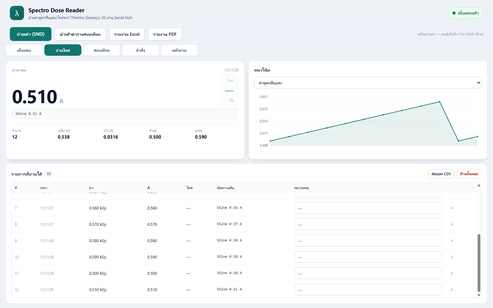
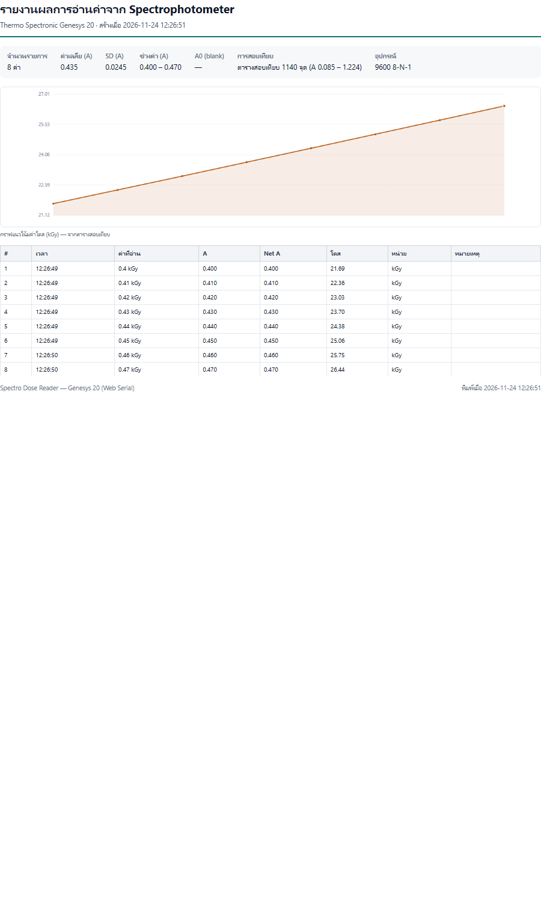

# Spectro Dose Reader

เว็บแอปแบบ static (HTML/CSS/JS ล้วน ไม่ต้องติดตั้งอะไรเพิ่ม) สำหรับ **อ่านค่าจากเครื่อง Thermo Spectronic Genesys 20** ผ่านพอร์ตอนุกรมด้วย Web Serial API แล้วแปลงค่าดูดกลืนแสงเป็น **โดส** ตามเส้นสอบเทียบ พร้อมตาราง สถิติ กราฟ และส่งออก CSV



> ภาพตัวอย่างมาจากโหมดข้อมูลจำลอง (ยังไม่ได้ต่อเครื่องจริง)

---

## ทำอะไรได้

- เชื่อมต่อพอร์ต COM (RS-232 / USB-Serial) จากในเบราว์เซอร์โดยตรง ไม่ต้องลงโปรแกรมฝั่งเครื่อง
- ตั้งค่า baud rate / data bits / stop bits / parity / flow control ได้
- แยกค่าจากข้อความที่เครื่องส่งมา 4 โหมด: อัตโนมัติ, ตัวเลขตัวแรก, ตัวเลขตัวสุดท้าย, regex กำหนดเอง
- กล่องทดสอบ parser (พิมพ์ข้อความตัวอย่างแล้วเห็นผลทันที) + หน้าต่าง **ข้อมูลดิบ** (ดูเป็น HEX ได้) ไว้หา baud/รูปแบบจริง
- แปลงเป็นโดสด้วย `D = k₁·(A − A₀) + k₂·(A − A₀)²`
- ถ้าเครื่องส่งค่าเป็น %T จะแปลงเป็น absorbance ให้อัตโนมัติ (คอลัมน์ A)
- ตารางผลพร้อมหมายเหตุรายรายการ, สถิติ (n, เฉลี่ย, SD, min, max), กราฟแนวโน้ม
- ปุ่ม **อ่านค่า (SND)** อยู่ด้านบน กดครั้งเดียวเพื่อขอค่าจากเครื่องโดยไม่ต้องไปกด Print — มี **เสียงยืนยัน** และ **popup แสดงค่า Absorbance + Dose** (ปิดด้วยปุ่มตกลง, `Enter` หรือ `Esc`)
- **คีย์ลัด `Ctrl + Shift` (Shift ซ้าย)** กดสองปุ่มนี้แล้วปล่อย = สั่งอ่านค่า SND (ใช้ได้แม้โฟกัสอยู่ในช่องกรอกข้อมูล) — ถ้ากดปุ่มอื่นต่อ (เช่น Ctrl+Shift+R) ระบบจะไม่สั่งอ่านค่า
- เลย์เอาต์ **เต็มความกว้างจอ** แบ่ง 4 เมนู: **อ่านโดส / พลังงาน / สอบเทียบ / เชื่อมต่อ·คำสั่ง**
  - หน้า **เชื่อมต่อ / คำสั่ง** (เมนูสุดท้าย) รวมการตั้งค่าพอร์ต + สั่งอ่านค่าจากคอมพิวเตอร์ + ข้อมูลดิบ
  - หน้า **อ่านโดส** แยกออกมาเต็มความกว้าง: ค่าล่าสุด + กราฟแนวโน้ม + ตารางการอ่าน
  - หน้า **พลังงาน** ใช้สองคอลัมน์ (ตั้งค่าซ้าย + กราฟ/ตารางขวา) — ใช้งานจบในหน้าเดียว ตารางมีแถบเลื่อนในกรอบของตัวเอง
- **รายงาน Excel** (`.xlsx` จริง มี 3 ชีต: Readings / Calibration / Info) และ **รายงาน PDF** (ผ่านหน้าต่างพิมพ์ → เลือก “Save as PDF”)
- **นำเข้าตารางสอบเทียบจาก Excel/CSV** แล้วคำนวณโดสด้วยการ interpolate ตามตาราง (นอกช่วงใช้การต่อเส้นจากช่วงปลาย)
- ส่งออก CSV (UTF-8 + BOM เปิดใน Excel ได้เลย) — หน้า **อ่านโดส** ส่งออก readings, หน้า **พลังงาน** มีปุ่ม **ส่งออก CSV** ส่งตาราง Depth/Ai/Dose พร้อมสรุป Ea/Ep/Dmax/R50/Rp/R²
- บันทึกข้อมูลลง localStorage อัตโนมัติ (สูงสุด 1,500 รายการ) และ **เลื่อนตารางไปแถวล่าสุดที่เพิ่งอ่านให้อัตโนมัติ**
- โหมดข้อมูลจำลอง ไว้ทดลอง UI โดยไม่ต้องมีเครื่อง

---

## เริ่มใช้งาน

### แบบที่ 1 — เปิดไฟล์เดียว (ไม่ต้องรันเซิร์ฟเวอร์)

ดับเบิลคลิก **`spectro-dose.html`** แล้วเปิดด้วย **Chrome หรือ Edge** ได้เลย
ไฟล์นี้มี CSS/JS ทั้งหมดอยู่ในตัว ใช้งานออฟไลน์ได้ และ Chrome ถือว่า `file://` เป็น secure context จึงใช้ Web Serial ได้

- ถ้าดับเบิลคลิกแล้วเปิดด้วยเบราว์เซอร์อื่น (เช่น Firefox) ให้คลิกขวา → **Open with** → Chrome/Edge
- ไฟล์นี้สร้างจากซอร์สในโปรเจกต์ ถ้าแก้โค้ดใน `js/` ให้รัน `node build-standalone.mjs` เพื่อสร้างใหม่

### แบบที่ 2 — ผ่าน localhost (ทางเลือกสำรอง)

ดับเบิลคลิก **`start.cmd`** จะเปิดเซิร์ฟเวอร์ localhost และเปิด Chrome/Edge ให้อัตโนมัติ

หรือรันเอง:

```powershell
cd spectro-dose
node serve.mjs
```

แล้วเปิด <http://127.0.0.1:8765>

ถ้าเครื่องนี้ยังไม่มี `node` ใน PATH ให้ใช้ Node ที่มากับ DSH:

```powershell
& "$env:USERPROFILE\.dsh\dsh-runtimes\dsh-primary-runtime\dependencies\node\bin\node.exe" serve.mjs
```

เปลี่ยนพอร์ตได้ด้วย `$env:PORT=8790; node serve.mjs`

> ถ้าเบราว์เซอร์เวอร์ชันใดบล็อก Web Serial บน `file://` ให้ใช้วิธีที่ 2 นี้แทน — ตัวแอปทำงานเหมือนกันทุกอย่าง

---

## ขั้นตอนใช้งานกับเครื่องจริง

1. ต่อสาย DB9 จากช่อง RS-232 ของ Genesys 20 เข้ากับ USB-Serial adapter ที่ติดตั้งไดรเวอร์แล้ว
2. เปิด **`spectro-dose.html`** ด้วย Chrome/Edge (หรือ <http://127.0.0.1:8765>)
3. **ตั้งค่าเครื่อง (ทำครั้งเดียว):** กด **Utility → Printer setup** → Change → เลือก **Serial** → Accept
   และ **Utility → RS232** ตั้ง baud ให้ตรงกับแอป (ปกติ 9600, 8, none, 1) → Accept
4. ในแอป ตรวจ baud ให้ตรง → เลือก **พอร์ต (COM)** จาก dropdown → กด **เชื่อมต่อ**
   ถ้ารายการยังว่าง ให้กด **เลือกพอร์ต…** แล้วเลือกอุปกรณ์ในหน้าต่างของ Chrome (หลังอนุญาตแล้วพอร์ตจะอยู่ใน dropdown ครั้งต่อ ๆ ไป)
   ถ้าเลือกผิดพอร์ต ให้กด **ตัดการเชื่อมต่อ** แล้วเลือกพอร์ตอื่นจาก dropdown
5. กด **Print** ที่หน้าเครื่องหนึ่งครั้ง (1 ครั้ง = ส่ง 1 ค่า) แล้วเปิด **“ข้อมูลดิบจากพอร์ต”** ดูว่าเครื่องส่งอะไรมา
6. ถ้าตัวเลขขึ้นถูกต้องแล้ว ข้ามไปข้อ 7; ถ้ายังไม่ถูกให้เลือก “วิธีอ่านค่า” ให้ตรง หรือเขียน regex เอง
7. ใส่ **A₀** (blank), **k₁**, **k₂** จากผลสอบเทียบ แล้วติ๊ก **“เปิดใช้เส้นสอบเทียบ”**
8. ตรวจผลในตาราง → ใส่หมายเหตุถ้าต้องการ → กด **ส่งออก CSV**

> เครื่องจะส่งค่าก็ต่อเมื่อถูกสั่ง (กด **Print** หรือคอมพิวเตอร์ส่งคำสั่งขอค่า) ไม่ได้สตรีมตลอดเวลา — ถ้าต้องการหลายค่าก็ต้องกด Print ซ้ำทุกครั้ง หรือใช้ชุดคำสั่ง RS-232 ของรุ่นนี้ผ่านช่อง “ส่งคำสั่ง”

### ตัวอย่างรูปแบบข้อมูลที่ parser รองรับ

| ข้อความที่เครื่องส่ง | ผลลัพธ์ |
| --- | --- |
| `   552nm  0.001 A` (รูปแบบจริงที่ยืนยันจากเครื่อง) | 0.001 A |
| `600NM 0.412 A` | 0.412 A |
| `574NM -01.5 A` | −1.5 A |
| `ABS 0.123` | 0.123 A |
| `600NM 100.0 T` หรือ `45.6 %` | %T (แปลงเป็น A ให้) |
| `23/11/2026 17:11:04 0.123 A` | 0.123 A (ข้ามวันที่/เวลา) |

**ยืนยันจากเครื่องจริงแล้ว:** Genesys 20 ส่งข้อมูลที่ **9600 8-N-1** เมื่อกด `Print` โดยบรรทัดมีรูปแบบ
`<ความยาวคลื่น>nm  <ค่า> <โหมด>` ปิดท้ายด้วย **CR (0x0D)** อย่างเดียว เช่น `   552nm  0.001 A`

- `A` = Absorbance (ใช้คำนวณโดส), `T` = %Transmittance, `C` = Concentration
- **อย่าใช้ค่าโหมด `C` มาคำนวณโดส** — ให้กด `A/T/C` ที่เครื่องให้เป็น `A` ก่อนวัด

### อ่านค่าโดยไม่ต้องกด Print (คำสั่ง `SND`)

รุ่นนี้รับคำสั่งผ่าน RS-232 (ชุดคำสั่ง 3 ตัวอักษร) — คำสั่ง **`SND`** จะทำให้เครื่องส่งค่าอะบซอร์แบนซ์กลับมาทันที

- ในแอป: กดปุ่ม **อ่านค่า (SND)** (แอปตั้ง line ending เป็น `CR` ให้อัตโนมัติ)
- ต้องการอ่านต่อเนื่อง: ติ๊ก **ส่งซ้ำอัตโนมัติทุก 1 วินาที**
- คำสั่งอื่น: `MODEL` (รุ่น), `REV` (เวอร์ชันซอฟต์แวร์)
- ที่มา: เอกสารของ Datalyse (ซอฟต์แวร์ที่รองรับ Genesys 20) ระบุ baud 9600, no parity, 1 stop, 8 data bits และใช้คำสั่ง `SND` ในการขอค่าอ่าน

### สร้างตารางสอบเทียบจากโดสมาตรฐาน (แท็บ “สอบเทียบ”)

ใช้เมื่อมี **dosimeter ที่ผ่านการฉายรังสีและรู้ค่าโดสแล้ว** — การ์ด **5 · สร้างตารางสอบเทียบจากโดสมาตรฐาน**:

1. **ล็อก 16 ตัวอย่าง · โพลิโนเมียลดีกรี 10** (ไม่มีตัวเลือกดีกรีแล้ว — ดีกรี 10 ให้ค่าคลาดเคลื่อนต่ำสุด 0.006% กับเส้นตัวอย่าง)
2. กด **“แนะนำ 16 ค่าโดส”** → ระบบเติมระดับโดสที่แนะนำ 16 ระดับ กระจายเท่ากันตลอดช่วงของตารางที่นำเข้า (เช่น 2.25–73.19 kGy → 2.249, 6.978, …, 73.194)
   - ถ้าฉายรังสีให้ตรงค่าแนะนำไม่ได้ ให้ใช้ **ค่าใกล้เคียงที่วัดได้จริง** แล้วกรอกค่านั้น (ระบบใช้ค่าที่กรอก)
   - หรือถ้ามีไฟล์ตัวอย่างอยู่แล้ว กด **“ดึง 16 จุดจากตารางที่นำเข้า”** เพื่อดึงทั้ง A และ Dose จากตาราง
3. อ่านค่า **Absorbance** ด้วย SND — ถ้าเปิด “เก็บค่า Absorbance อัตโนมัติ” ค่าจะเติมลงแถวถัดไปให้เอง
   - **เกณฑ์บังคับ:** ต้องกรอกครบตามจำนวนจุดที่เลือก · ต้องมีจุดครอบ **ต้น/กลาง/ปลาย** ของช่วง Absorbance · ช่องว่างระหว่างจุด ≤ **35%** ของช่วง — ถ้าไม่ผ่านจะไม่ยอมสร้างไฟล์/ใช้เป็นตาราง
   - ตาราง 881 จุดเป็นเพียง **ความละเอียดของ lookup** ไม่ได้กำหนดจำนวนตัวอย่าง
4. กด **สร้างไฟล์ Excel สอบเทียบ** → ได้ไฟล์ `calibration-standard-*.xlsx` (คอลัมน์ A = Absorbance, B = Dose + หัวตาราง) นำกลับเข้าแอปได้ทันที
   - ช่อง **ขยายตารางเป็น (จุด)** (ค่าเริ่มต้น 881) จะสร้างตารางละเอียดตามจำนวนที่ตั้ง
   - ไฟล์ Excel ที่ได้มีชีต `Equation` เก็บดีกรี/center/สัมประสิทธิ์ ไว้ใช้คำนวณต่อได้
   - คำเตือน: สมการดีกรีสูงใช้ได้เฉพาะ **ในช่วง A ที่วัด** ไม่ควร extrapolate
5. กด **ใช้เป็นตารางสอบเทียบ** → ตั้งเป็นตารางหลัก (เปิดใช้ให้อัตโนมัติ) และใช้ต่อในแท็บพลังงาน

### ตารางสอบเทียบจาก Excel

ปุ่มนำเข้าอยู่ในการ์ด **4 · แปลงเป็นโดส** (แท็บสอบเทียบ) — นำเข้าแล้วระบบจะสลับไปใช้ตารางให้อัตโนมัติ

**รูปแบบไฟล์ (ตายตัว):** คอลัมน์ **A = absorbance**, คอลัมน์ **B = dose**, **แถว 1 = หัวตาราง (ไม่ถูกอ่านเป็นข้อมูล)**

| A | Dose (kGy) |
| --- | --- |
| 0.085 | 2.2487 |
| 0.086 | 2.3070 |
| 0.087 | 2.3653 |

- ใช้เฉพาะคอลัมน์ A และ B — คอลัมน์ C ขึ้นไปไม่ถูกนำมาใช้
- แถว 1 จะถูกข้ามเมื่อเป็นข้อความ (หัวตารางชื่ออะไรก็ได้) แต่ถ้าแถวแรกเป็นตัวเลขอยู่แล้วจะถือว่าเป็นข้อมูลแถวแรก
- **หน่วยโดส** อ่านจากหัวตาราง (`kGy` / `Gy` / `mGy` / `cGy`) — ถ้าไม่ระบุจะถือว่า **kGy** และแอปตั้งหน่วยให้อัตโนมัติ
- เปลี่ยนตารางใหม่ในอนาคตได้เรื่อย ๆ ตราบใดที่ยังใช้รูปแบบ A/B นี้

- ค่าที่วัดได้จะถูกนำไป **เทียบกับตาราง (interpolate)** โดยใช้ค่า A ตามที่วัดตรง ๆ — โหมดตารางจะ **ไม่หัก A₀** (ช่อง A₀ จะซ่อนไป ใช้เฉพาะโหมดสูตร)
- นอกช่วงตาราง ระบบจะประมาณต่อเส้นจากสองจุดปลาย และแจ้งเตือนว่า “นอกช่วงตาราง”
- มีช่อง **ทดสอบค่า A** ไว้เทียบค่ากับ Excel ได้ทันที (เช่นใส่ `0.25` → ได้ค่าโดสที่ตรงกับตาราง)
- ทดสอบกับตารางละเอียด 1,140 จุด (A 0.085–1.224) แล้วทำงานได้ปกติ
- ไฟล์ตัวอย่างสำหรับลอง import: `test/fixtures/calibration.xlsx`

### วัดพลังงานลำอิเล็กตรอน (แท็บ “พลังงาน”)

แท็บนี้ **ใช้ตารางสอบเทียบตัวเดียวกับแท็บสอบเทียบ** (A → Dose) ไม่ต้องนำเข้าตารางแยก

**กราฟ depth–dose:** เมื่ออยู่แท็บพลังงาน พื้นที่กราฟหลักจะขยายเต็มความกว้าง (ซ่อนการ์ด “ค่าล่าสุด” ที่ไม่มีข้อมูล) และแสดงเส้น depth–dose (Dose vs Depth) พร้อม **เส้น tangent** และจุด **R50/Rp**

**โหมดจำลอง:** ใส่ **พลังงาน Ea (MeV)** และ **Dmax (kGy)** (ค่าเริ่มต้น 31 kGy ตามตัวอย่าง) แล้วกด **ตกลง / จำลอง** — ระบบสร้างเส้น depth–dose ที่มีสัดส่วน **Rp/R50 แบบเดียวกับ `energy test.xlsx`** เติมค่าลงตาราง 60 แถว:
- โหมด **Dose** → ได้ค่าโดส (kGy) โดยตรง (ไม่ต้องมีตารางสอบเทียบ)
- โหมด **Ai** → แปลงกลับเป็น Ai ผ่านตารางสอบเทียบ (จำกัด Dmax ไม่เกินขอบเขตตาราง)
ตัวอย่าง: ใส่ 19.2 MeV / Dmax 31 → ได้ Dmax 31.000 · R50 3.138 · Rp 4.176 · **Ea 19.261 · Ep 21.245 MeV** (ใกล้ตัวอย่าง Excel: 19.201 / 21.244)
ระบบ **ปรับ seed อัตโนมัติ** (สูงสุด 5 รอบ) ให้ Ea ที่คำนวณได้ตรงกับพลังงานที่ใส่ — ทดสอบช่วง **3–25 MeV** ทั้งโหมด Dose และ Ai พบความคลาดเคลื่อน |Ea − input| ≤ 0.005 MeV (ที่ 3 MeV มีคำเตือน R² ต่ำเพราะช่วง tangent สั้น)

**ส่งออก Excel ฟอร์ม (Dose Conversion):** ปุ่ม **ส่งออก Excel ฟอร์ม** ในหน้าพลังงาน — สร้าง `.xlsx` 2 ชีต
- `Dose Conversion` — ตาราง Ai/Depth/Response/Dose/Adjusted Dose พร้อม **สูตรจริง** `VLOOKUP`, `SLOPE`, `INTERCEPT`, `R50`, `Rp`, `Ea`, `Ep` (เหมือน `energy test.xlsx`)
- `Dose Table` — ตารางสอบเทียบที่นำเข้า (ใช้เป็นช่วงของ VLOOKUP)
เปิดใน Excel แล้วสูตรจะคำนวณเอง (ตั้ง `fullCalcOnLoad` ไว้)

**กรอกโดสโดยตรง:** สลับโหมดเป็น **“Dose (kGy) โดยตรง”** เพื่อพิมพ์ค่าโดสเอง (ไม่ต้องมีตารางสอบเทียบ) และเลือกหน่วยโดส (kGy/Gy/cGy/mGy) ได้

1. นำเข้าตารางสอบเทียบที่แท็บ **สอบเทียบ** (ถ้ายังไม่มี) — แท็บพลังงานจะใช้ตารางเดียวกัน
2. ตารางมี **60 แถว** พร้อมระยะลึกคงที่ **0.1812 – 5.6633 cm** (ตามไฟล์ `dose table ED.xlsx`) — **อ่านค่าด้วย SND/Print ขณะอยู่แท็บนี้ ค่า Ai จะถูกเติมลงแถวถัดไปตามลำดับระยะลึกอัตโนมัติ** (หรือกด **เก็บค่าล่าสุด** เองก็ได้) ตาราง Depth/Ai/Dose แสดงใน **พื้นที่หลักกลางจอ** เมื่ออยู่แท็บพลังงาน
3. **เลือกช่วงข้อมูล**: ค่าเริ่มต้นเป็น **อัตโนมัติ** โดยไล่หน้าต่าง **5–14 จุด** หลัง Dmax หา R² ของแต่ละขนาด — ถ้ามีขนาดที่ R² ≥ 0.999 จะเลือกหน้าต่างที่ **ใหญ่ที่สุด** (จุดมากที่สุด) เพื่อความเสถียร; ถ้าไม่มีจึงใช้ R² สูงสุด — ถ้าต้องการเลือกเองให้ปิด “เลือกช่วงอัตโนมัติ” แล้ว **คลิกแถวแรก = จุดเริ่ม คลิกแถวที่สอง = จุดสิ้นสุด** (หรือพิมพ์เลขแถวในช่อง Fit) ระบบจะแสดง **R² / slope / จำนวนจุด** ให้ตัดสินใจ (แนะนำ R² ≥ 0.98 และอย่างน้อย 5 จุด)
   - เทียบกับไฟล์ตัวอย่าง `energy test.xlsx`: สูตรตรงกันทุกตัว (R50/Rp/Ea/Ep) — ถ้าเลือกช่วง **แถว 27–40** เหมือนใน Excel จะได้ค่าเดียวกันทุกหลัก (มี unit test ตรวจไว้) และตอนนี้แสดง Ea/Ep ทศนิยม 3 ตำแหน่งเหมือน Excel
4. ระบบคำนวณให้:
   - `Dose = lookup(Ai)` จากตารางสอบเทียบ (interpolate)
   - `R50 = (Dmax/2 − intercept) / slope`, `Rp = −intercept / slope` (จากเส้น tangent ที่ลากผ่านช่วงข้อมูล)
   - `Ea = 0.99 × 6.2 × R50` MeV, `Ep = 0.99 × 5.09 × Rp + 0.2` MeV
     (ตาม ISO/ASTM A3.19, A3.18 และ ICRU Report 35)

### รายงาน

- **รายงาน Excel / PDF จะอิงหน้าที่เปิดอยู่**
  - หน้า **อ่านโดส** → รายงานการอ่าน (Readings / Calibration / Info)
  - หน้า **พลังงาน** → รายงานวัดพลังงาน (Energy: Dmax/R50/Rp/Ea/Ep + กราฟ depth–dose + ตาราง depth/Ai/Dose) — ไฟล์ Excel จะเปิดที่ชีต **Energy เป็นแผ่นแรก**
- **รายงาน Excel** — สร้างไฟล์ `.xlsx` จริง พร้อม **ฝังกราฟเป็นรูปในชีต** (กราฟโดสในชีต Readings / กราฟ depth–dose ในชีต Energy)
- **รายงาน PDF** — เปิดหน้าต่างพิมพ์ของเบราว์เซอร์ ให้เลือกปลายทาง **“Save as PDF”** (ได้ข้อความคมชัดและตัดหน้าอัตโนมัติ)
  ภายในรายงานการอ่านมี **กราฟแนวโน้มค่าโดส** (สีส้ม) ฝังอยู่ก่อนตารางเพียงกราฟเดียว (ไม่แสดงกราฟ absorbance)
  ส่วนรายงานพลังงานจะมีกราฟ depth–dose พร้อมเส้น tangent และตาราง 60 แถว

  

โหมดอัตโนมัติจะข้ามเลขความยาวคลื่น (`600NM`) วันที่ และเวลา และไม่รับบรรทัดสถานะอย่าง `GENESYS 20 READY` เป็นค่าที่อ่านได้

---

## เรื่องเฉพาะของ Genesys 20 (อ่านก่อนต่อเครื่อง)

- Genesys 20 มีพอร์ต **RS-232 (DB9)** และพอร์ตปริ้นเตอร์ Centronics — ต้องต่อช่อง RS-232 ให้ถูก
- สายที่ใช้ต้องต่อขาให้ถูกตามคู่มือ (รุ่นที่ขายเป็นชุดมักใช้สาย **GEX P4130** หรือสาย null-modem) — **สาย straight-through ทั่วไปอาจไม่ทำงาน**
- เครื่องอาจ **ไม่ส่งค่าอัตโนมัติ** ต้องกด Print หรือส่งคำสั่งถาม (ชุดคำสั่ง RS-232 ของ Genesys 20 ใช้คำสั่ง 3 ตัวอักษร) — ถ้าต้องถามทุกครั้ง ใช้ช่อง “ส่งคำสั่ง” + ติ๊ก “ส่งซ้ำอัตโนมัติ”
- `9600 8-N-1` เป็นเพียงค่าเริ่มต้นที่พบบ่อย ที่เหลือต้องยืนยันจากคู่มือเครื่อง; ถ้าได้ตัวอักษรแปลก ๆ ให้ลอง 1200 / 2400 / 4800 / 19200
- ปิดโปรแกรมอื่นที่ยึด COM port อยู่ก่อน (WINdose, DoseControl, PuTTY, โปรแกรมอ่านเครื่องชั่ง ฯลฯ)
- **absorbance ไม่เท่ากับ dose** — ต้องมีเส้นสอบเทียบของ dosimeter แต่ละ batch/รุ่น และระบุหน่วยให้ตรง (Gy, mGy, cGy, kGy)

---

## ข้อจำกัดของ Web Serial

- ใช้ได้กับ **Chrome / Edge** เท่านั้น (Firefox, Safari ไม่รองรับ)
- เบราว์เซอร์ **ไม่เปิดเผยเลข COM** (COM3, COM4) — ในแอปจะแสดงเป็น “พอร์ต 1 — CH340” ตามลำดับและรุ่นชิป USB; ใช้ dropdown + ปุ่ม “เลือกพอร์ต…” ในการเลือก/เปลี่ยนพอร์ต
- พอร์ตหนึ่งใช้ได้ทีละแท็บ; ปิดแท็บ/รีเฟรช = หยุดรับข้อมูล (ค่าที่บันทึกไว้ยังอยู่)
- ต้องกดปุ่มเพื่อขอสิทธิ์เข้าพอร์ตทุกครั้งหลังเปิดหน้าใหม่ (เบราว์เซอร์จะจำอุปกรณ์ให้)
- ไม่ทำงานเบื้องหลัง ไม่มี auto-start; ถ้าสายหลุดต้องกดเชื่อมต่อใหม่
- ข้อมูลเก็บใน localStorage ของเบราว์เซอร์เครื่องนั้น ไม่ sync ข้ามเครื่อง — ถ้าต้องการเก็บถาวรให้ส่งออก CSV

---

## โครงสร้างโปรเจกต์

```
spectro-dose/
├─ spectro-dose.html    ⭐ ไฟล์เดียวจบ (ดับเบิลคลิกเปิดได้ ไม่ต้องรันเซิร์ฟเวอร์)
├─ index.html          หน้าจอต้นฉบับ (ใช้ร่วมกับ js/ + styles.css)
├─ styles.css          ธีม/เลย์เอาต์ (responsive)
├─ js/
│  ├─ app.js           สถานะ UI, ตาราง, สถิติ, CSV, calibration, รายงาน
│  ├─ parser.js        ตัวแยกวิเคราะห์ค่าจากบรรทัด (pure functions)
│  ├─ serial.js        Web Serial: เปิด/อ่าน/แบ่งบรรทัด/ส่งคำสั่ง/ปิด
│  ├─ chart.js         กราฟ Canvas 2D (ไม่ใช้ไลบรารีภายนอก)
│  ├─ calibration.js   ตารางสอบเทียบ + interpolate + อ่าน CSV
│  ├─ energy.js        ตาราง Dose (Response→Dose) + คำนวณ R50/Rp/Ea/Ep
│  ├─ xlsx.js          ตัวอ่าน/เขียนไฟล์ .xlsx (ไม่ใช้ไลบรารีภายนอก)
│  └─ report.js        สร้างโมเดลรายงาน + หน้ารายงานสำหรับพิมพ์/PDF
├─ test/
│  ├─ parser.test.mjs        22 เทสต์ของ parser/ตัวแปลงหน่วย
│  ├─ calibration.test.mjs   9 เทสต์ของตารางสอบเทียบ/interpolate
│  ├─ xlsx.test.mjs          3 เทสต์อ่าน/เขียน .xlsx
│  ├─ energy.test.mjs        10 เทสต์คำนวณพลังงาน/R50/Rp
│  ├─ dom-contract.test.mjs  ตรวจว่า id ที่ JavaScript ใช้มีจริงใน HTML
│  └─ fixtures/calibration.xlsx  ไฟล์ตัวอย่างสำหรับทดสอบ import
├─ build-standalone.mjs  รวมทุกไฟล์เป็น spectro-dose.html
├─ serve.mjs           static server ขนาดเล็ก (localhost)
├─ start.cmd           ตัวเปิดแอปแบบ localhost สำหรับ Windows
├─ preview.png         ภาพตัวอย่างหน้าจอ
└─ preview-report.png  ภาพตัวอย่างรายงาน PDF (มีกราฟ)
```

---

## ทดสอบ

```powershell
node test/parser.test.mjs
node test/dom-contract.test.mjs
node test/calibration.test.mjs
node test/xlsx.test.mjs
node test/energy.test.mjs
```

หรือ `npm test`

ระหว่างพัฒนาได้ทดสอบกับเบราว์เซอร์จริงผ่าน Chrome headless + CDP ทั้งแบบ `http://localhost` และแบบเปิดไฟล์ `file://` (ตรวจว่าโหลดหน้า, โหมดจำลอง, ตาราง/สถิติ/กราฟ, parser และปุ่ม CSV ทำงานโดยไม่มี console error)

---

## ถ้าต้องการใช้ประจำในห้องแล็บ

เวอร์ชันนี้เป็น frontend ล้วน เหมาะกับการใช้งานเร็ว ๆ บนเครื่องเดียว หากต้องการระบบที่ทนกว่า แนะนำทำ backend เล็ก ๆ ด้วย Python + `pyserial` (FastAPI) เพื่อ:

- รับค่าตลอดเวลาและ reconnect อัตโนมัติเมื่อสายหลุด
- เก็บข้อมูลลง SQLite/Postgres พร้อม audit trail
- ให้หลายเครื่อง/หลายสถานีเปิดดูพร้อมกัน
- ตรวจ QC (ค่า blank, ซ้ำ, ช่วงยอมรับ) และออกรายงาน

แจ้งได้เลยหากต้องการต่อยอดเป็นเวอร์ชันนี้
